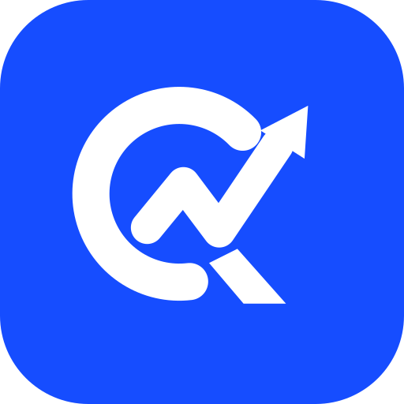

# QueryAction plugin

[QueryAction](https://queryaction.com) is an MCP server for site growth. This plugin connects your agent (Cursor, Grok Bot, and other Open Plugins hosts) to the QueryAction remote MCP server so it can:

- Read **Google Search Console** and **Google Analytics 4** data for your sites
- Run **PageSpeed audits** and public page reads
- Do **keyword, backlink, competitor and AI-visibility research**
- Track **opportunities and Work** (proposed changes, evaluations)
- Produce **weekly growth reports**

## What's included

| Component | Path |
| --- | --- |
| Remote MCP server `queryaction` → `https://queryaction.com/mcp` (Streamable HTTP) | `mcp.json` |
| Skill: `weekly-growth-review` | `skills/weekly-growth-review/SKILL.md` |
| Manifests | `.cursor-plugin/plugin.json` (Cursor), `plugin.json` (Agent Plugins) |

## Install

- **Cursor / Grok Bot marketplace:** install "QueryAction" from the marketplace.
- **Local:** clone this repo into `~/.cursor/plugins/local/queryaction` and reload.
- **Any MCP client:** add `https://queryaction.com/mcp` as a remote (HTTP) MCP server named `queryaction`.
  - Claude Code: `claude mcp add --transport http --scope user queryaction https://queryaction.com/mcp`
  - Codex: `codex mcp add queryaction --url https://queryaction.com/mcp`

## Authentication

OAuth 2.1 with dynamic client registration. No API keys or environment variables. On first use your client opens a browser to sign in to QueryAction. Never paste a token or password into chat.

## Getting started

Ask your agent: "Connect QueryAction and tell me how example.com is doing on Google search." The agent calls `get_started` and `list_sites`, then offers to connect Search Console and GA4.

## Tools (selection)

- Setup: `get_started`, `list_sites`, `add_site`, `get_site`, `get_site_context`, `update_site_context`
- Google connections: `begin_gsc_connection`, `get_gsc_connection_status`, `begin_ga4_connection`, `get_ga4_connection_status`, `list_ga4_properties`, `confirm_ga4_connection`, `check_ga4_install`
- Data: `get_tracking_snapshot`, `get_ga4_tracking_snapshot`, `get_tracking_breakdown`, `get_weekly_report`, `request_gsc_collection`, `request_ga4_collection`
- Research: `request_pagespeed_audit`, `request_public_page_read`, `request_web_search`, `request_keyword_opportunities`, `request_backlink_research`, `request_backlink_opportunities`, `request_competitor_comparison`, `request_ai_visibility`, `get_research`, `list_research`, `get_opportunity`, `list_opportunities`, `get_evidence`
- Playbooks & Work: `get_playbook`, `propose_work`, `list_work`, `get_work`, `update_work`, `claim_work`, `complete_work`, `begin_work_review`, `request_work_evaluation`, `get_work_evaluation`, `record_change`, `list_changes`
- Account: `get_account_usage`

## Pricing

Founder plan US$39/month. See [queryaction.com](https://queryaction.com).

## Privacy

[queryaction.com/privacy](https://queryaction.com/privacy)

## License

MIT
